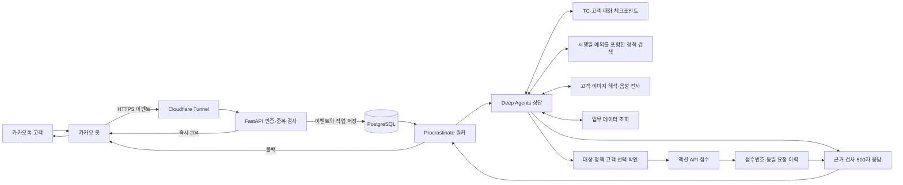

# 교동마을 카카오톡 상담 에이전트

교동마을·갯마을 조합몰의 주문, 배송, 환불, 프로모션, 정기배송을 상담하는 AI_TOP_100 대회용 에이전트다. 주민에게 받은 원문과 실제 업무 API를 대조하고, 조건을 확인한 요청을 접수한다.

**운영 종료: 2026-11-01.** 대회용 Docker 컨테이너·프로젝트 이미지·네트워크, Cloudflare 터널·DNS, 카카오 웹훅을 정리했다. 소스와 조사 자료, DB·로그는 보존했다. 재가동하려면 이미지 빌드와 터널·DNS·웹훅 재설정이 필요하다.

대회에서는 로컬 Docker를 Cloudflare Tunnel로 `https://kakao.mingon.dev`에 연결했다. 웹훅 주소는 `https://kakao.mingon.dev/webhooks/kakao`였으며, 공유기 포트 개방이나 고정 IP 없이 공개 HTTPS를 사용했다. 아래 구성과 실행 방법은 재구축을 위한 기록이다.

## 처리 흐름



액션 API의 `SUBMITTED`는 요청 접수다. 환불 지급이나 배송지 반영이 끝났다고 표현하지 않는다. 결과가 불명확한 요청은 원래 본문을 보존하며, 새 본문으로 다시 접수하지 않는다.

## 구성

| 부분 | 구현 |
|---|---|
| 수신·큐 | FastAPI, PostgreSQL, Procrastinate. 대화별 순서·중복 이벤트 처리 |
| 에이전트 | Deep Agents, LangGraph 체크포인트, 긴 대화 요약 |
| 상담 문맥 | TC 변경 시 고객·주문·도구 관측·접수 기록 분리. 실행 중단 후 문맥 복구 |
| 접근권 | 초기 공식 계정 메타데이터와 회원 원장을 대조하고 주문 귀속 확인. 타인 정보와 저장된 수령인 개인정보를 모델 전달 전에 차단 |
| 정책 | 원문별 ID, 시행 시점·예외·공개 범위를 포함한 검색과 부분 읽기 |
| 업무 API | 공식 OpenAPI 입력·응답 검증, TC 헤더, 조회와 접수 구분 |
| 이미지·음성 | 고객이 실제 보낸 대회 CDN 자료만 읽기. 기계 해석과 확정 사실 구분 |
| 확장 | 도메인 팩의 Python 도구, MCP, Skills, SDK 미들웨어 |
| 응답 제한 | 최종 근거 포함 500자. 수신 후 55초 기한, 에이전트 최대 40초 |

Compose에서는 모델 12회·도구 24회 상한을 사용한다. 실제 실행은 시간 제한을 함께 적용한다. 기본 모델은 `gpt-6.1-sol`이며, 서비스 티어는 `MODEL_SERVICE_TIER`로 지정한다. 입력 한도는 48,000토큰, 요약 시작 기준은 36,000토큰이다. 정책 의미와 고객 의도 판단은 실제 모델 검증 대상이며, 출처 ID 검사만으로 모든 문장의 정확성이 보장되지는 않는다.

서로 다른 대화는 최대 4개까지 처리하고, 같은 대화는 DB 작업 잠금으로 순서를 지킨다. 대기 시간도 55초 응답 기한에 포함된다.

## 실행

키는 `.local/secret/`에 둔다. Git과 Docker 이미지에 포함하지 않는다.

```text
.local/secret/
├── OpenAI_API_KEY
├── ai-top-100-kakao-admin-key.txt
├── ai-top-100-action-api-token
├── cloudflare_tunnel_token
├── postgres_password
├── webhook_secret
└── ops_token
```

```bash
uv sync --frozen
cp .env.example .env
# 실제 접수 기능은 .env의 ACTION_API_WRITES_ENABLED=true로 활성화
uv run python -c "from pathlib import Path; from kakao_bot.runtime.packs import lock_pack; lock_pack(Path('domain_packs/gyodong'))"
docker compose build api
docker compose --profile tunnel up -d
```

`ACTIVE_PACK=gyodong`, `BOT_MODE=agent`를 사용한다. `BOT_MODE=echo`는 연결 점검용이다. 카카오 콘솔의 `X-Bot-Secret` 값은 `webhook_secret` 파일과 일치해야 한다. 다른 앱으로 옮길 때는 `CHANNEL_SCOPE`도 변경한다.

Cloudflare는 공개 HTTPS를 Docker 내부의 `http://api:8000`으로 전달한다. `.dev`의 HTTPS 조건을 충족한다. PC·인터넷·Docker Desktop이 유지되어야 서비스가 동작한다.

운영 중 자료를 수정하려면 검증한 팩을 별도 디렉터리에 복사하고 `PACKS_HOST_PATH`로 지정할 수 있다. 운영 팩 파일은 실행 중 직접 편집하지 않는다. 설정·팩·코드 변경 후 API와 워커를 함께 재시작한다.

```bash
docker compose up -d --force-recreate api worker
```

## 도메인 팩

```text
domain_packs/gyodong/
├── pack.yaml                 # 버전·허용 도구
├── pack.lock.json            # 검토한 파일의 SHA-256
├── instructions/AGENTS.md    # 상담·조회·접수 지침
├── skills/customer-service/ # 업무별 자료 지도와 절차
├── adapters.py              # TC·접수 문맥 미들웨어
├── tools.py                 # 정책·API·계산 도구
├── access.py                # 계정·주문 접근권과 결과 필터
├── order_context.py         # 주문·배송·품질·결제 연결 조회
├── media.py                 # 이미지·음성 입력
└── data/
    ├── action-openapi.json
    ├── policies.json        # 검토된 업무 정책
    └── records.json         # 출처 등록부
```

도구는 `case_context`, `search_policy`, `read_policy`, `inspect_order`, `action_get`, `action_submit`, `calculate`, `read_customer_media`다. `inspect_order`는 내부 기록을 연결해 읽는 도구이며 접수하지 않는다. 초기화 API는 에이전트 도구에 노출하지 않는다. API 접수 기능은 `ACTION_API_WRITES_ENABLED`로 제어한다.

주제별 Python 도구·MCP·훅 연결은 [어댑터 가이드](docs/ADAPTERS.md)를 따른다. `equipment_demo`와 `notice_demo`는 합성 자료를 이용한 기존 회귀 검증용 팩이다.

## 검증

```bash
# 유료 모델 없이 단위·SDK·DB 통합 검사
./ops/test.sh -q

# 로컬 또는 공개 HTTPS 수신 경로 확인
python3 ops/smoke_http.py
python3 ops/smoke_http.py --base-url https://kakao.mingon.dev

# 실제 모델 검증 옵션 확인
uv run python evals/gyodong_live.py --help
```

실제 모델·액션 API 검증 기록은 `.local/ai_top_100/verification/`에 둔다. 공개 초기 대화와 검증용 고객 후속 발화를 구분하고, 기대 정답을 고객 입력이나 운영 정책에 넣지 않는다. 연습용 API 접수도 실제 요청이므로 같은 본문·접수번호를 기록한다.

인수 이후 변경·실제 카카오 왕복·업무별 성공과 남은 실패는 [구현 검증 보고서](.local/implementation/v3/IMPLEMENTATION-MAIN-20261031.md)에 기록한다. 새 유료 검증은 팩과 함께 런타임 소스·의존성 잠금 파일도 동결한다. 운영과 같은 호출 한도로 재현하려면 `MAX_MODEL_CALLS=12 MAX_TOOL_CALLS=24`를 지정한다.

콜백 전송 후 응답이 유실되면 전달 여부를 `unknown`으로 남긴다. 중복 답장을 막기 위해 자동 재전송하지 않는다. 외부 카카오 전송까지 정확히 한 번을 보장하는 구조는 아니다.

장시간 관측 컨테이너는 사용하지 않는다. 운영 DB 보존을 위해 `docker compose down --volumes`를 실행하지 않는다. 대회 최종 제출과 이후 변경·초기화는 별도로 관리한다.

- [운영 명령](ops/README.md)
- [초기 구현·검증](.local/implementation/v1/README.md)
- [확장 어댑터 준비](.local/implementation/v2/README.md)
- [대회 자료·인터뷰·검증](.local/ai_top_100/00-시작.md)
- [이전 설계 v1~v6](.local/plan/README.md)

`.local/`의 원문·인터뷰·검증 결과·키는 로컬에 보존한다.
