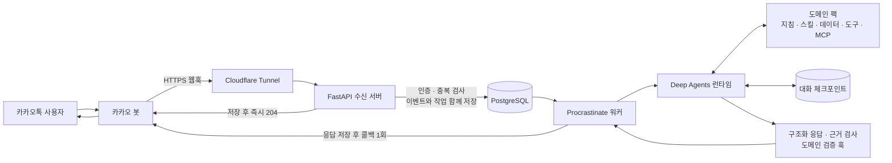
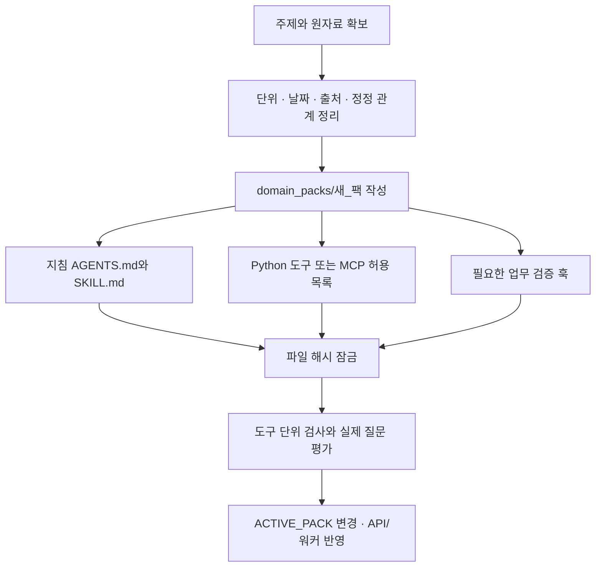

# 카카오톡 업무 에이전트

카카오톡 메시지를 받아 자료를 조회하고, 계산과 근거 확인을 거쳐 답하는 AI_TOP_100 대회용 에이전트 기반이다. 주제별 데이터·도구·스킬을 **도메인 팩**으로 교체한다.

Python 서버와 에이전트 워커를 로컬 Docker에서 실행하고, Cloudflare Tunnel로 `https://kakao.mingon.dev`에 연결한다. 공유기 포트 개방이나 고정 IP는 필요 없다. 카카오 웹훅 주소는 `https://kakao.mingon.dev/webhooks/kakao`다.

## 전체 흐름



PostgreSQL 하나에 수신 이벤트, 작업 큐, 응답 상태, 대화 체크포인트를 저장한다. 모델이 답을 만드는 동안 카카오 웹훅 연결을 붙잡고 있지 않는다.

## 구현된 기능

| 부분 | 동작 |
|---|---|
| 카카오 연결 | `X-Bot-Secret` 인증, 메시지 중복 제거, 비동기 콜백, 채널 대화 수신 |
| 작업 실행 | 대화별 순서 유지, 작업·응답 영속화, 중단된 에이전트 체크포인트 복구 |
| 컨텍스트 | 사용자·대화·팩 버전별 분리, PostgreSQL 저장, 긴 대화 요약과 원문 보관 |
| 도구 | 팩별 Python 도구와 MCP 허용 목록, 도구 시간·호출 횟수 제한 |
| 스킬·파일 | `SKILL.md` 선택 로딩, 자료 읽기, 대화별 `/scratch/` 작업 공간 |
| 훅·응답 검증 | SDK 미들웨어 연결, 구조화된 답변, 실제 조회한 출처 확인, 팩의 `validate_answer` 훅 |
| 운영 | HTTPS, 컨테이너 자동 재시작, 건강 상태 검사, 모델 사용량·추정 비용 기록 |

현재 모델은 `gpt-5.4-mini-2026-03-17`로 고정했다. 실행당 모델 최대 8회, 도구 최대 12회, 전체 180초를 기본 한도로 둔다. 요약에도 같은 호출 예산을 적용한다.

포함된 `equipment_demo`와 `notice_demo`는 **합성 검증 자료**다. 각각 정정된 장비 재고와 신청 마감일을 확인한다. 실제 예약·신청·외부 데이터 변경은 구현하지 않았다. 현재 팩으로 업무 답변을 보내면 예시 자료라는 문구를 붙인다.

## 실행

Docker Compose와 아래 파일을 준비한다. 키 값은 Git과 이미지에 들어가지 않는다.

```text
.local/secret/
├── OpenAI_API_KEY
├── ai-top-100-kakao-admin-key.txt
├── cloudflare_tunnel_token
├── postgres_password
├── webhook_secret
└── ops_token
```

`postgres_password`, `webhook_secret`, `ops_token`은 직접 생성한 서로 다른 임의 문자열이다. 현재 카카오 콘솔에는 `webhook_secret`과 같은 값을 `X-Bot-Secret` 헤더로 등록했다. 다른 앱으로 옮길 때는 `compose.yaml`의 `CHANNEL_SCOPE`와 카카오 설정도 맞춰야 한다.

```bash
cp .env.example .env
# 최초 연결 검사는 BOT_MODE=echo, AI 동작은 BOT_MODE=agent
docker compose build api
docker compose --profile tunnel up -d
docker compose ps
```

Cloudflare의 기존 Named Tunnel은 `kakao.mingon.dev`를 `http://api:8000`으로 전달한다. 공개 구간은 HTTPS이고, 로컬 Docker 내부에서만 HTTP를 사용한다. `.dev`의 HTTPS 조건을 충족한다.

모드·모델·팩을 바꾸면 **API와 워커를 함께** 반영한다. 이벤트를 받을 때 실행 설정을 저장하므로 설정 변경 전의 대기 작업도 확인해야 한다.

```bash
# .env 수정 후
docker compose up -d --force-recreate api worker
```

## 대회 주제에 맞추기



```text
domain_packs/equipment_demo/
├── pack.yaml                  # ID·버전·데이터 버전·도구·MCP 선언
├── pack.lock.json             # 검토한 파일의 SHA-256
├── instructions/AGENTS.md     # 해당 업무의 지침
├── skills/availability/SKILL.md
├── tools.py                   # build_tools(data), 선택적 validate_answer(...)
├── data/records.json          # 출처 ID를 포함한 자료
└── resource_graph.json        # 자산과 출처 관계를 나타내는 선언 자료
```

- **Python 도구:** `build_tools(data)`에서 LangChain 도구를 반환하고, 이름을 `allowed_tools`에 등록한다. 도구 반환값에 `status`, `data`, `evidence`, `effect`를 담는 예제가 있다.
- **MCP:** `stdio`와 `streamable_http` 연결을 지원한다. 실행할 스크립트·주소·허용 도구를 팩에 명시한다. 인증 환경 변수는 `env_allowlist` 또는 `headers_env`로 지정하고 워커에도 직접 전달해야 한다. 임의의 채팅 내용으로 서버를 연결하지 않는다.
- **검증 훅:** `validate_answer(answer, tool_results)`로 업무별 규칙을 추가할 수 있다. 장비 예제는 조회한 재고와 예약 수량으로 핵심 답변을 직접 구성한다. 출처 ID 검사만으로 모든 자연어 주장의 진위를 보장하지는 않는다.
- **컨텍스트:** 대화 기억과 요약은 기본 제공한다. 사용자 전체에 걸친 장기 기억, 벡터 검색, 그래프 데이터베이스가 필요하면 해당 문제에 맞춰 별도로 붙인다. `resource_graph.json` 자체가 검색 엔진은 아니다.

팩을 수정한 뒤 검토한 파일의 해시를 갱신한다. 팩 버전과 데이터 버전도 함께 올린다.

문제별 연결 위치와 예외 처리 기준은 [어댑터 가이드](docs/ADAPTERS.md)에 정리했다. 도구·스킬은 기존 방식으로 추가하고, 컨텍스트 선택이나 도구 결과 변환은 선택적 `adapters_module`의 SDK 미들웨어로 처리한다. 특수 MCP 연결에는 같은 모듈의 transport 팩토리를 사용할 수 있다.

```bash
uv sync --frozen
uv run python - <<'PY'
from pathlib import Path
from kakao_bot.runtime.packs import lock_pack
print(lock_pack(Path('domain_packs/equipment_demo')))
PY
```

팩 변경 시 이전 팩의 대화 문맥을 재사용하지 않는다. 쓰기 기능이나 새로운 업무 도구를 추가하면 권한, 중복 실행, 결과 확인 절차도 그 기능에 맞게 구현해야 한다.

## 검증과 운영

```bash
# 유료 API 없이 SDK·도구·MCP·수신·작업·DB 통합 검사
./ops/test.sh -q

# 모델 호출 없이 로컬/공개 HTTPS 경로 검사
python3 ops/smoke_http.py
python3 ops/smoke_http.py --base-url https://kakao.mingon.dev

# 필요할 때만 운영 상태 관측: 현재는 사용자 요청으로 중지
docker compose --profile monitor up -d monitor
python3 ops/report_monitor.py

docker compose logs --tail 100 api worker cloudflared
```

`/health/live`는 프로세스, `/health/ready`는 DB 연결을 확인한다. 인증된 `/ops/status`에는 대기 작업·워커 심박·응답 상태·사용량이 나온다. 실제 모델 평가는 `evals/live.py`로 따로 실행한다. 실행 방법과 관측 결과는 로컬 구현 보고서에 기록한다.

콜백 요청을 보낸 뒤 응답이 유실되면 전달 여부를 `unknown`으로 남긴다. 중복 답장을 피하려고 자동 재전송하지 않는다. 이 구조가 외부 카카오 전송까지 정확히 한 번을 보장하는 것은 아니다.

PC·인터넷·Docker Desktop이 살아 있어야 서비스가 유지된다. 현재 Windows의 AC 절전은 꺼 두었고 컨테이너는 자동 재시작한다. 장시간 관측 컨테이너는 중지했으며 봇은 계속 실행한다. 로그인 전 무인 복구나 정전 대응은 별도 운영 범위다. 데이터 보존을 위해 운영 환경에서 `docker compose down --volumes`를 사용하지 않는다.

- [운영 명령과 설정 복원](ops/README.md)
- [어댑터 준비·검증 v2](.local/implementation/v2/README.md)
- [구현·검증 결과 v1](.local/implementation/v1/README.md)
- [이전 설계 v1–v6](.local/plan/README.md)

`.local/`의 설계·증거·키는 로컬 전용이며 원격 저장소에는 포함되지 않는다.
